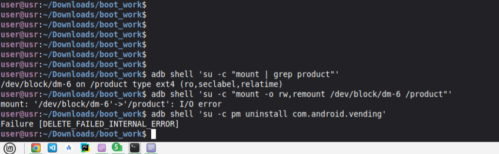
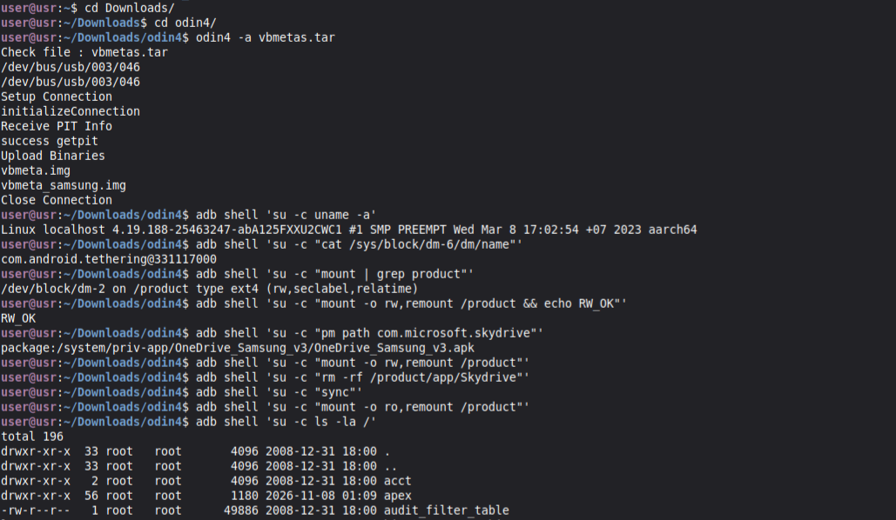

## A125F-Verification-Bypass

#### Bypass vbmeta/AVB verification on the Samsung Galaxy A12 (SM-A125F) - mount,remount /product and fully remove system apps.

Requirements: Bootloader must be unlocked.

### [~] boot.img:

Pre-compiled Magisk init with an AVB-disabling patch and 'noverity' flags.

Method: remove avb and add noverity lines, compile with magiskboot lib.

### [~] vbmeta.img / vbmeta_samsung.img:

Both images are patched with the VERIFICATION_DISABLED flag;

Method: xxd -s 0x78 -l 4 vbmeta_samsung.img / vbemeta.img, compile with avbtool.

### Warning:

My firmware (stock, self-modifing): https://samfw.com/firmware/SM-A125F/PNG/A125FXXU2CWC1

Files tested and patched only on firmware at top (Android 12, Security patch 2023.01.01, Bootloader: 2).

Ready .img in patched_imgs/ repo folder, do NOT use on other firmware versions.

Patch simply by Odin4 on your computer OS.

Note on EDL: In theory, you can do all of this via mtkclient in EDL (BROM) mode. But I didn't tested it on A125, not like A325 repo.

Telegram & Discord: @islavikfx

